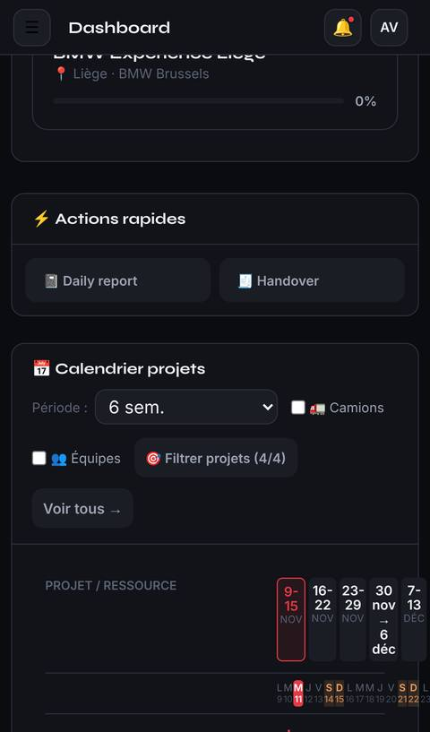
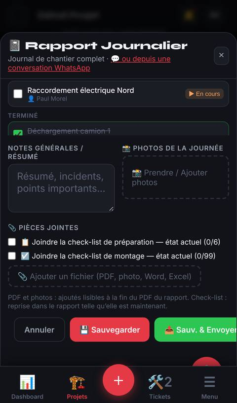
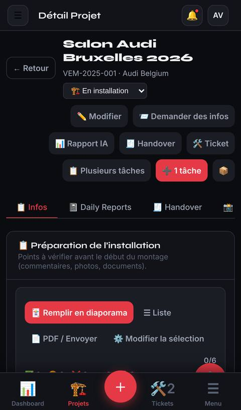
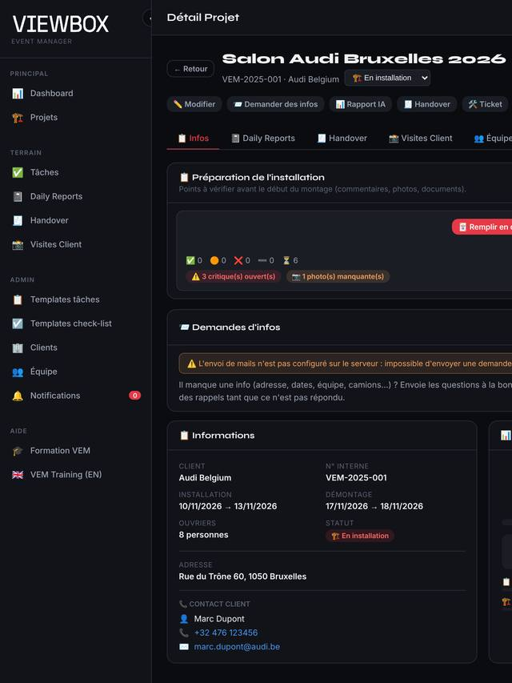
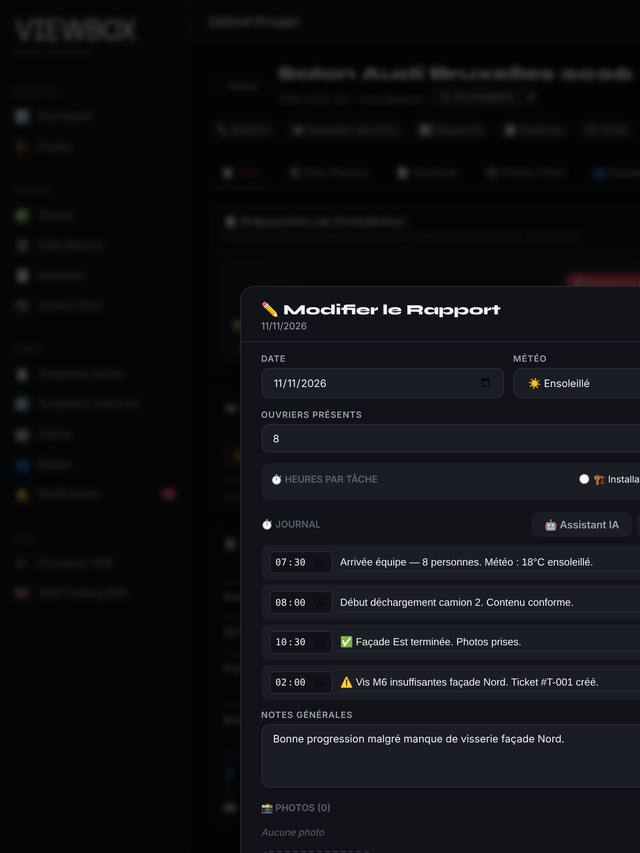
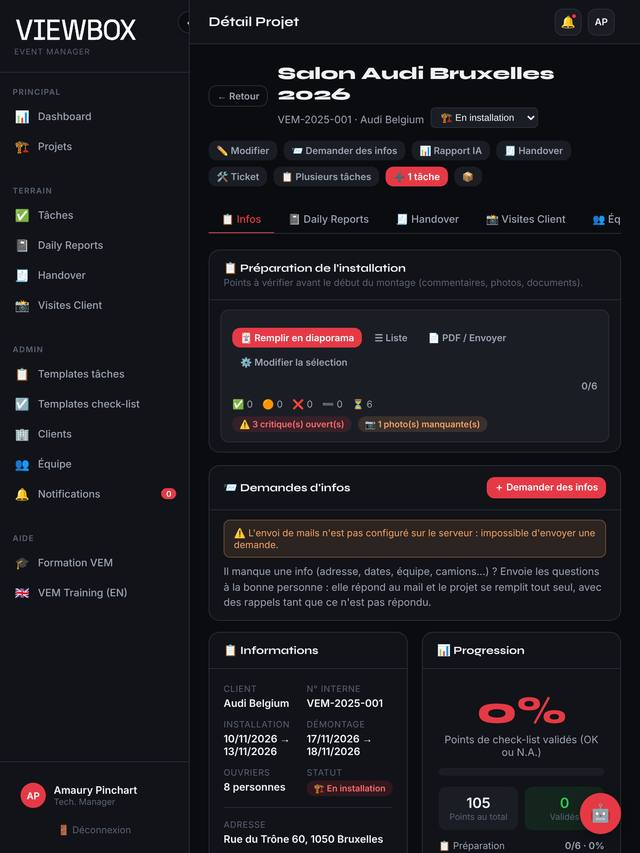

# Audit téléphone / tablette de VEM — 11.11.2026

Demande d'A. Pinchart (11.11.2026) : « reprends tout le site en te mettant en tant qu'intégrateur
senior pour téléphone, iPad, tablette et ordinateur… boutons mal placés, boutons qui ne
fonctionnent pas, planning qui continue à droite après l'écran, daily report : quand on bouge un
peu trop vite l'écran ça revient en arrière, on ne sait pas défiler jusqu'au bout pour enregistrer…
on fait un check complet, puis un prompt, et on décide ensuite de coder. »

Ce document = le **check complet**. Le prompt de travail qui en découle est
`docs/mobile/PROMPT_Refonte_Mobile_Tablette.md`. Rien n'a été modifié dans l'app.

**Périmètre** : l'app VEM (`public/index.html`, `public/css/app.css`, `public/js/01…19`) et les
pages publiques (`sign-handover.html`, `info-request.html`, `planning-public.html`,
`viewer3d.html`, `plan2d-studio.html`). Hors périmètre : le module Plans Viewbox (`/plans/`), qui a
déjà sa propre version téléphone / tablette (T1–T2).

**Méthode**
1. VEM lancé en local sur une base de test (données de démo + projets autour d'aujourd'hui, un nom
   de projet très long comme sur ta capture), puis ouvert comme sur **6 appareils** : iPhone 14,
   Pixel 7, petit Android (360 px), iPad portrait (810 px), iPad paysage (1080 px), ordinateur
   (1440 px). Chaque page, chaque onglet du projet et 11 fenêtres (daily nouveau / lecture /
   édition, projet, tâche, handover, check-list liste + diaporama, import WhatsApp, demande
   d'infos, planning de montage) sont mesurés et photographiés. L'outil est versionné :
   `tests/mobile/audit.mjs` (mode d'emploi `tests/mobile/README.md`).
2. Lecture du code de toutes les pages par zone (daily & check-lists ; projet & fenêtres ; Briefing
   Studio & pages publiques).
3. **Limite** : c'est Chromium en émulation, pas un vrai Safari. Les débordements, recouvrements
   et tailles sont fiables ; le défilement à l'inertie, la barre d'outils de Safari, le clavier et
   le geste retour sont déduits du code et marqués « à confirmer sur appareil ».

---

## 1. En bref — les 6 causes qui expliquent presque tout

| # | Cause | Ce que tu vois | Où |
|---|---|---|---|
| 1 | **Une seule chose trop large élargit toute la page.** Aucun garde-fou contre le débordement horizontal. | iPhone : la page glisse de côté (ta capture du planning). Android : la page se dézoome et la barre du bas sort de l'écran. **iPad : toute l'app est plus large que l'écran**, en portrait comme en paysage (cloche, boutons, colonnes coupés à droite ; les fenêtres s'ouvrent à moitié hors écran). | Téléphone : planning du dashboard, barre de recherche des projets, grilles écrites « en dur ». iPad : **une ligne CSS** (`.main` sans `min-width: 0`, § 4) |
| 2 | **Un tap sur le fond ferme la fenêtre, sans rien demander.** La règle « on ne ferme plus au clic sur le fond » a été appliquée à une partie des fenêtres seulement : **28 fenêtres** se ferment encore, dont **la lecture et l'édition d'un daily report**. | « Quand je bouge trop vite, ça revient en arrière » (cause la plus probable, à confirmer sur ton iPhone) : le doigt qui lance ou arrête un défilement sur la bande sombre au-dessus de la fenêtre (ou pendant son ouverture) = un tap sur le fond → la fenêtre disparaît, la saisie est perdue. | `04-edit-clients-templates.js:664`, `07-auth-mobile-daily-ai.js:1195`, `02-detail-loaders.js:672` + 25 autres (liste § 3.2) |
| 3 | **Les fenêtres ne sont pas faites pour le téléphone.** La barre du bas (et le bouton 🤖) restent **par-dessus** les fenêtres ; plusieurs listes défilent **dans** la fenêtre qui défile elle-même ; la page derrière défile aussi ; les boutons Enregistrer sont tout en bas du contenu, pas fixés. | « On ne sait pas défiler jusqu'au bout pour enregistrer » : le geste est capté par une liste intérieure ou par la page derrière, le pouce en bas tape la barre de navigation, et le contenu bouge sous le doigt pendant qu'il se charge. | `app.css:172` / `:335-340`, `index.html:894-961`, `04-edit-clients-templates.js:588` / `:628` |
| 4 | **Pas de bouton « retour » géré.** L'app ne connaît pas l'historique du navigateur. | Geste retour Android ou bord gauche iPhone = on quitte la page (retour au site d'avant ou à la connexion), fenêtre et saisie perdues. | `01-core.js:568` (`goto` n'utilise pas l'historique) |
| 5 | **La tablette est traitée comme un ordinateur.** Au-dessus de 768 px : barre latérale de 240 px, souris supposée (survol, petites cibles, glisser-déposer), rien n'est adapté au doigt. | iPad = la version ordinateur, serrée et qui déborde ; petits boutons ; infobulles jamais visibles. | `app.css:405` (`min-width:769px`), aucune règle `pointer: coarse` |
| 6 | **≈ 2 800 lignes de styles écrits directement dans le JavaScript** (`style="…"`). | Le CSS « mobile » ne peut pas les corriger : chaque écran a sa propre mise en page figée (grilles en px, rangées de boutons sans retour à la ligne). | Tous les `public/js/*.js` |

Les causes 1 à 4 se corrigent vite et règlent l'essentiel des plaintes. Les causes 5 et 6
demandent une vraie refonte de l'interface (voir le prompt).

**Captures** (`docs/mobile/captures/`, émulation Chromium) :

| | | |
|---|---|---|
|  iPhone : le planning dépasse de la carte → la page glisse |  iPhone : barre VEM et ＋ par-dessus le daily, « Sauv. & Envoyer » coupé, liste qui défile dans la fenêtre |  iPhone : l'en-tête du projet prend la moitié de l'écran |
|  iPad portrait : page projet coupée à droite (cloche absente) |  iPad portrait : « Modifier le rapport » à moitié hors écran |  iPad portrait : même page avec `.main { min-width: 0 }` |

---

## 2. Ce qui marche déjà bien (à garder)

- La **vue plein écran des check-lists** (liste et diaporama) : plein écran sans `100vh`, barre du
  bas masquée, zones de sécurité iPhone, diaporama au doigt (`touch-action: pan-y`) correct.
- Les champs de formulaire passent en 16 px sur téléphone (pas de zoom iOS à la saisie).
- Les fenêtres principales passent en « feuille du bas » sur téléphone, avec une marge en bas.
- Les onglets du projet défilent de côté.
- Les photos des check-lists ont `capture="environment"` (appareil photo direct) et sont réduites
  avant envoi.
- Aucun rafraîchissement automatique (minuterie, temps réel) ne vient réécrire une fenêtre ouverte.

---

## 3. Constats détaillés

Gravité : **B** = bloquant (on ne peut pas faire la tâche / on perd des données), **G** = gênant,
**C** = cosmétique. Appareils : 📱 téléphone, 📲 tablette, 🖥️ ordinateur.

### 3.1 Structure de l'app (coque, navigation)

| # | Grav. | App. | Constat | Où | Correction |
|---|---|---|---|---|---|
| S1 | B | 📱📲 | Aucun garde-fou contre le débordement horizontal ; un élément trop large élargit la page et déplace tout ce qui est fixé (barre du bas, toasts, fenêtres). Mesuré : dashboard iPhone 640 px de large pour un écran de 390 px. | `app.css` (pas de `overflow-x: clip`, pas de `min-width: 0` sur les colonnes) | Garde-fou global + corriger chaque source (S2, P1, P3, D6…) |
| S2 | B | 📲🖥️ | **iPad portrait et paysage** : la page projet est 477 px (portrait) / 207 px (paysage) plus large que l'écran → cloche, boutons, colonne « Progression » coupés ; la fenêtre « Modifier le rapport » s'ouvre à moitié hors écran (croix et Enregistrer invisibles). Cause : `.main` (élément flex) garde la largeur de son contenu le plus large. Idem sur un portable < ≈ 1 290 px. | `app.css:39` (`.main`) | **`.main { min-width: 0 }`** (vérifié : 477 → 0 et 207 → 0), puis mode tablette (barre latérale en icônes, grilles qui se replient) |
| S3 | B | 📱 | La **barre du bas est au-dessus des fenêtres** (z-index 9999 contre 500) : elle cache le bas de chaque fenêtre et capte les gestes du pouce ; un tap dessus change la page sous la fenêtre et remonte en haut (`goto` → `scrollTo(0,0)`). | `app.css:335-340`, `01-core.js:579` | Masquer la barre du bas dès qu'une fenêtre est ouverte (comme le fait déjà la vue check-list, `15-checklists.js:829`) |
| S4 | B | 📱📲 | **Pas d'historique** : geste retour = sortie de l'app. | `01-core.js:568` | Une entrée d'historique par page et par fenêtre ouverte ; retour = ferme la fenêtre / revient à la page d'avant |
| S5 | G | 📱📲 | Bouton **🤖 assistant** fixé en bas à droite au-dessus des fenêtres (z-index 9000) mais **sous** la barre du bas : à moitié caché, et posé sur les boutons des fenêtres. | `01-core.js:421` | Le mettre dans le menu ＋ sur téléphone, le masquer quand une fenêtre est ouverte |
| S6 | G | 📱 | L'onglet **« Tickets »** de la barre du bas s'affiche alors que le module Tickets est caché ailleurs (`display:none` écrasé par `.bn-item{display:flex!important}`), et son compteur « 2 » n'a pas de style (texte collé à l'icône). | `index.html:125`, `app.css` (`.bn-item`, pas de `.bn-badge`) | Remplacer par une destination utile (Daily / Mes chantiers), styler le badge |
| S7 | G | 📱 | Deux menus ☰ identiques (en haut et en bas). L'onglet actif de la barre du bas reste sur la page précédente (ex. « Projets » allumé sur Templates, « Dashboard » sur un projet ouvert par le planning). | `index.html:217`, `:132`, `01-core.js:595` | Une seule entrée menu, onglet actif recalculé à chaque page |
| S8 | G | 📱 | Le menu ＋ (Daily, Handover, Point visite) utilise le « projet courant » même quand aucun projet n'est ouvert. | `index.html:139-143` | Demander le projet si aucun n'est ouvert |
| S9 | G | 📱📲🖥️ | **Toasts** (messages « enregistré », erreurs) en haut à droite, 240 px minimum, sous les studios (z-index 9000 < 10000) → invisibles dans le Briefing Studio ; sur téléphone ils cachent la cloche. | `app.css:206`, `03-create-forms.js:1017` | Toasts en bas au centre au-dessus de la barre sur téléphone, toujours au premier plan |
| S10 | G | 📱📲 | Champs date / heure natifs **en clair sur fond sombre** (icône calendrier noire sur noir) : pas de `color-scheme: dark`. | `app.css :root` | `color-scheme: dark` |
| S11 | G | 📱 | `maximum-scale=1.0` empêche de zoomer avec deux doigts sur Android (accessibilité). iOS l'ignore pour le zoom mais s'en sert pour ne pas zoomer à la saisie. | `index.html:5` | Retirer après avoir passé tous les champs à 16 px sur écran tactile |
| S12 | C | 📲🖥️ | Page de connexion collée à gauche (382 px) au lieu d'être centrée quand on arrive déconnecté (le conteneur passe en `flex` sans largeur). | `07-auth-mobile-daily-ai.js:299/310/377` | `width:100%` sur `.login-wrap` |
| S13 | C | 📱📲 | Pas d'icône d'écran d'accueil, de favicon, de couleur de barre ni de manifeste ; `/favicon.ico` renvoie la page entière (93 Ko). `env(safe-area-*)` sans effet (pas de `viewport-fit=cover`). | `index.html` `<head>`, `src/index.ts:201` | Icônes + manifeste (préalable à une « app » installable) |
| S14 | G | 📱 | Fabric + jsPDF + html2canvas (≈ 0,9 Mo) chargés à chaque ouverture de l'app, même en 4G sur le chantier. | `index.html:11-13` | Charger à la demande (Briefing / export) |

### 3.2 Fenêtres (modales)

| # | Grav. | App. | Constat | Où | Correction |
|---|---|---|---|---|---|
| M1 | B | 📱📲 | **28 fenêtres se ferment sur un tap sur le fond**, sans confirmation : lecture / édition / envoi du daily, configuration et export de check-list, camions, templates, clients, visites, handover… | `02-detail-loaders.js:505, 672, 815, 910, 991` · `03-create-forms.js:988, 1168` · `04-edit-clients-templates.js:44, 217, 664, 1166` · `05-templates-trucks-reports.js:114, 165, 205, 446, 546, 657, 932` · `07-auth-mobile-daily-ai.js:125, 1195` · `08-visits-remarks.js:18, 365` · `10-logistics-bookings.js:379` · `15-checklists.js:245, 332, 592, 636, 1438` | Ne fermer que par ✕ / Annuler / retour, avec « Quitter sans enregistrer ? » si quelque chose a changé |
| M2 | B | 📱 | **Listes qui défilent dans la fenêtre qui défile** : création du daily (240, 260, 340, 300 px), édition (200 px + 30 % de l'écran = 61 % de la surface mesurée). Le geste reste accroché à la liste ; sur iOS son rebond ressemble à un retour en arrière. | `index.html:894, 916, 934, 961`, `04-edit-clients-templates.js:588, 628` | Sur téléphone : une seule zone qui défile (la fenêtre), listes à hauteur libre |
| M3 | B | 📱 | **Boutons d'action en bas du contenu, pas fixés** ; il faut tout faire défiler, et sur un vrai iPhone la barre Safari + la barre VEM + le clavier mangent le bas. | Toutes les fenêtres | Pied de fenêtre collant (Enregistrer toujours visible) |
| M4 | B | 📱 | **La page derrière défile aussi** (rien ne la bloque) : un geste qui sort de la fenêtre fait bouger la page sous elle. | `03-create-forms.js:782` (`showModal`) | Bloquer le défilement de la page tant qu'une fenêtre est ouverte |
| M5 | G | 📱 | Le contenu **change de hauteur sous le doigt** : les pièces jointes du daily arrivent après coup (Enregistrer descend de 284 px) ; cocher une tâche dans la création recharge toute la liste (« Chargement… », la fenêtre remonte). | `04:667` → `16-daily-attachments.js:79` ; `03-create-forms.js:325` → `:290` | Réserver la place, mettre à jour la case sans tout recharger |
| M6 | G | 📱 | **Double tap = deux fenêtres d'édition identiques** (mêmes `id`) : on voit la 2ᵉ, on enregistre la 1ʳᵉ (cachée) → modifications perdues. | `04-edit-clients-templates.js:538` | Ne pas rouvrir si déjà ouverte + indicateur de chargement |
| M7 | G | 📱 | « Nouveau daily » déborde de côté : grille `2fr 1fr 1fr 1fr` écrite en dur, pied sans retour à la ligne → « Sauv. & Envoyer » coupé (mesuré 48 px de trop à 360 px). | `index.html:869`, `:1035-1041` | Une colonne sur téléphone, boutons qui passent à la ligne |
| M8 | G | 📱📲 | « Supprimer » ferme la fenêtre même si on répond « Annuler » à la confirmation. | `04-edit-clients-templates.js:658`, `07-auth-mobile-daily-ai.js:1186` | Fermer seulement après suppression réussie |
| M9 | G | 📱 | **Photos du daily** : chaque nouvelle photo prise **remplace** les précédentes ; échec d'envoi silencieux ; photos envoyées en pleine résolution en 4G. | `03-create-forms.js:478`, `:516-526` | Ajouter au lieu de remplacer, vérifier la réponse, réduire comme les check-lists |
| M10 | G | 📱 | Cibles minuscules qui **suppriment sans confirmer** : ✕ d'une tâche (26 × 15 px), ✕ d'une ligne de journal (≈ 20 px), ✕ / ✏️ photo (22–24 px) ; champs heures / hommes 85 × 22 px. | `03:107-113`, `04:690-698`, `04:747`, `04:643` | 44 px minimum au doigt, confirmation ou « annuler » |
| M11 | C | 📱 | `prompt()` pour la légende de photo, nombreux `confirm()` / `alert()` (bloquent l'écran, aspect système). | `04:924` et partout | Petites fenêtres maison |

### 3.3 Pages et onglets

| # | Grav. | App. | Constat | Où | Correction |
|---|---|---|---|---|---|
| P1 | B | 📱📲 | **Planning du dashboard** : colonne nom fixe de 200 px + 42 cases jour qui ne rétrécissent pas (≈ 460 px mini) → déborde de 250 px sur iPhone, et sur iPad. Flèches ▲▼ de 10 px. Infos seulement en infobulle (`title`). | `01-core.js:927, 966, 1000, 1029, 1055` | Téléphone : vue **agenda** (liste par semaine) ; tablette / ordinateur : Gantt dans sa propre zone qui défile, colonne nom collante, largeur de jour fixe, « aujourd'hui » centré |
| P2 | G | 📱 | **En-tête du projet** : « Retour » à côté du titre, puis 8 boutons sur 3 lignes → la moitié de l'écran avant d'arriver aux onglets ; la barre d'onglets n'est pas collante (il faut remonter pour changer d'onglet). | `index.html:340-375` | En-tête compact + menu « ⋯ Actions » + onglets collants |
| P3 | G | 📱 | **Recherche des projets** : liste de statuts (160 px) + tri (220 px) + case « archivés » sur une ligne sans retour → déborde. | `index.html:315-334` | Recherche pleine largeur, filtres dans un bouton « Filtres » |
| P4 | C | 📱📲🖥️ | Statuts et rôles affichés en code brut (`on_site`, `installation`, `site_manager`) sur les cartes projet et l'équipe. | page Projets, onglet Bookings | Libellés français (la table existe déjà pour l'en-tête) |
| P5 | G | 📱 | **Onglet Daily Reports** : la carte check-list se charge au-dessus de la liste en même temps → la liste descend d'≈ 250 px sous le doigt (taps au mauvais endroit). Toucher une carte ouvre directement l'**édition**. | `index.html:390`, `07:1109`, `02-detail-loaders.js:551` | Réserver la place ; toucher = lecture, « Modifier » dedans |
| P6 | G | 📱📲 | **Planning estimatif de montage** (éditeur plein écran) : dessiné pour la souris (cliquer-glisser, bords à 4–6 px), colonne tâche coupée (« Équipe sur s »), barre VEM par-dessus le bas. | `19-assembly-plan.js` | Téléphone : lecture + export ; tablette : poignées ≥ 44 px |

*(Constats de l'analyse « projet & fenêtres » ajoutés en § 3.6.)*

### 3.4 Briefing Studio

| # | Grav. | App. | Constat | Où |
|---|---|---|---|---|
| B1 | B | 📱 | **Studio Fabric inutilisable sur téléphone** : liste des slides fixe 200 px + ≈ 30 boutons sur 6 lignes → toile de ≈ 135 × 76 px sur un iPhone. | `12-briefing-studio-core.js:699-778` |
| B2 | B | 📱 | **Éditeur briefing classique** : grilles `240px 1fr`, `1fr 398px`, photo 280 px → ≈ 100 px pour écrire ; boutons d'en-tête qui débordent. | `11-briefing.js:285, 293, 431, 584, 614` |
| B3 | B | 📱 (iOS) | **« Imprimer » ne fait rien sur iPhone / iPad** : la fenêtre est ouverte après deux attentes réseau, Safari la bloque, erreur muette. | `11-briefing.js:927-1070` |
| B4 | G | 📱📲🖥️ | Messages (« sauvegardé », erreurs d'export) **invisibles dans les deux Studios** (toasts sous le Studio) ; le Studio Fabric n'a pas de sauvegarde automatique (iOS qui recharge l'onglet = travail perdu). | `app.css:206`, `12:649`, `briefing-next.css:4` |
| B5 | G | 📲 | iPad : poignées des objets 6–17 px à l'écran, boutons ≈ 26 px, icônes expliquées seulement par infobulle, pas de pincement sur les objets (module « gestes » absent de Fabric 5.3), menus qui sortent de l'écran. | `12-…`, `13-briefing-studio-slides.js:15, 550-553, 778` |
| B6 | G | 📱 | Studio Next : en-tête de 11 boutons sur 4–5 lignes, poignée de 4–6 px, sélection multiple seulement avec Maj, `90vh` au lieu de `dvh`. | `briefing-next.js:351`, `briefing-next-graphics.js:214`, `briefing-next.css:258` |
| B7 | G | 📱 | Mémoire iPhone : photos insérées en pleine résolution, deux toiles 3840 × 2160, export PDF de 2560 × 1440 par slide gardé en mémoire (à confirmer sur appareil). | `12:862-866`, `13:687-700` |
| B8 | G | 📱📲 | Polices du Studio (Helvetica, Impact, Comic Sans…) absentes sur Android / iOS → texte qui se coupe différemment selon l'appareil. | `12:730-741` |

**Recommandation** : téléphone = **consultation** (slides en plein écran, PDF, « édition sur tablette ou
ordinateur ») ; iPad = édition, de préférence en paysage, après adaptation. Investir dans
**Studio Next** (déjà en sauvegarde automatique, un bouton visible par action, CSS adaptable)
plutôt que dans le Studio Fabric pour le tactile.

### 3.5 Pages publiques (clients, écrans d'entrepôt)

| # | Grav. | App. | Constat | Où |
|---|---|---|---|---|
| X1 | B | 📱📲 | **Visionneuse 3D** (`viewer3d.html`, ouverte dans un nouvel onglet) : pas de `<head>` ni de viewport → page de 980 px sur téléphone ; **ne réagit qu'à la souris** (impossible de tourner / zoomer au doigt, iPad compris) ; panneaux fixes 280 + 230 px ; `100vh`. | `viewer3d.html:1, 24, 55, 66, 950-985` |
| X2 | B | 📱 | **Demande d'infos** (client sur téléphone) : après une erreur réseau ou une réponse refusée, le formulaire est reconstruit et **tout ce que le client a tapé est effacé** ; le message d'erreur apparaît en haut alors qu'il est en bas. | `info-request.html:165-173` |
| X3 | G | 📱📲 | **Signature du handover** : la zone de signature n'est pas recalculée quand on tourne le téléphone (trait déformé, partie droite morte) ; un simple tap est accepté comme signature. | `sign-handover.html:251-259, 274` |
| X4 | G | 📱 | Pages publiques : champs en 15 px → Safari zoome sur chaque champ et reste zoomé. | `sign-handover.html:29`, `info-request.html:32` |
| X5 | G | 📱🖥️ | **Planning public** : colonne nom collante de 280 px (≈ 3 jours visibles sur téléphone) ; sur une TV 1080p, 280 + 60 × 34 = 2 320 px > 1 920 → les ≈ 12 derniers jours hors écran, projets du bas cachés sans défilement automatique. | `planning-public.html:41` |
| X6 | G | 📱📲 | **Plan 2D Studio** : panneau 260 px, `100vh` + `overflow:hidden` (bas caché sous la barre iOS), cotes modifiables seulement par double-clic + `prompt`. | `plan2d-studio.html:14, 26, 794-804` |

### 3.6 Projet, onglets et fenêtres (suite)

| # | Grav. | App. | Constat | Où | Correction |
|---|---|---|---|---|---|
| H1 | **B** | 📱📲🖥️ | **Bouton « 📄 PDF » des cartes Handover mort sur tous les appareils** : il appelle `generateHandoverPDF`, qui n'existe nulle part. | `07-auth-mobile-daily-ai.js:1235` | Brancher sur la génération PDF existante du handover |
| H2 | B | 📱📲 | Carte Handover : 5 boutons sur une ligne sans retour (≈ 450 px) → « 🔗 Signer » et 🗑 hors écran sur téléphone **et iPad portrait**. | `07:1232-1238` | Retour à la ligne / menu « ⋯ » |
| H3 | B | 📱 | Vue handover complète : les deux zones de signature côte à côte (2 × 260 px) → la signature du client est hors écran ; pied de 5 boutons qui déborde à gauche (« Fermer » inatteignable) ; zone qui défile dans la fenêtre (50 vh). | `05-templates-trucks-reports.js:370, 409-430, 437` | Une colonne, zones de signature à la largeur, pied collant |
| H4 | G | 📱 | Édition du handover : lignes d'items qui débordent, « Annuler » coupé. | `09-files-team-users.js:937-953, 960` | Idem |
| F1 | B | 📱 | **Fichiers du projet** : case + icône + ▲▼ + 3–4 boutons qui ne rétrécissent pas → **le nom du fichier tombe à 0 px**, on ne voit plus aucun nom. Cause commune : `.btn-xs` n'a pas de marge propre (hérite de 8 × 16 px). | `08-visits-remarks.js:1111-1129`, `app.css:498` | `.btn-xs` réduit + actions sur une 2ᵉ ligne ou dans « ⋯ » |
| F2 | G | 📱 | Tuiles photo : ✕ 22 × 22 collé à ▲▼ 22 × 16 (mauvais tap facile) ; en-tête Fichiers qui déborde. | `08:1053-1063, 1097-1101` | Cibles 44 px, actions dans un menu |
| F3 | G | 📱📲 | Infos : un PDF affiché dans un cadre de 340 px par fichier → iOS n'affiche que la page 1, Android Chrome n'affiche rien (case vide, à confirmer) ; lourd en mémoire. | `02-detail-loaders.js:251` | Sur écran tactile : une ligne « Ouvrir » |
| F4 | G | 📱 | Miniatures chargées en pleine taille (4G chantier) ; une liste sans chargement différé. | `02:229`, `08:1093` | URL Cloudinary réduite (`w_300`) |
| F5 | G | 📱 | Visionneuse d'image : « ⬇️ Télécharger » à 14 px du bas → sous la barre VEM ; pas de zoom (S11). | `01-core.js:163` | Remonter au-dessus de la barre / barre masquée |
| F6 | G | 📱 (iOS) | Téléchargements par lien temporaire supprimé aussitôt après le clic : peut échouer sur iOS (à confirmer). | `01-core.js:59-66`, `08:290-296` | Délai avant suppression, ou partage natif sur écran tactile |
| C1 | G | 📱 | **En-têtes de carte sans retour à la ligne** : cartes à 2–3 boutons qui débordent → toute la page glisse (Infos › Fichiers, Équipe, Templates). | `app.css:121`, `02:183-195, 309-314`, `05:44-56` | `flex-wrap` sur `.card-header` |
| C2 | G | 📱 | Onglets du projet : 10 onglets, barre de défilement cachée, l'onglet actif n'est pas ramené à l'écran → Bookings / Briefing / Fichiers invisibles sans le savoir. | `index.html:371`, `01-core.js:601` | Indicateur « il y en a d'autres », onglet actif centré |
| C3 | C | 📱📲 | En-tête des fenêtres (marges négatives ≠ marges de la fenêtre) : dépasse de 6 à 10 px → la feuille « tangue » de côté. | `app.css:183, 188, 477, 518` | Aligner les marges |
| C4 | G | 📱 | Toasts posés exactement sur la croix ✕ des fenêtres pendant 3,5 s, et ils captent les taps. | `app.css:206-207` | S9 |
| E1 | G | 📱 | Équipe du projet : tableau de 6 colonnes, actions 📤 / ✕ hors écran ; téléphones non cliquables (`tel:`). | `02:316-337` | Cartes par membre, liens `tel:` / `mailto:` |
| E2 | G | 📱 | Bookings : colonnes `minmax(340px…)` / `minmax(360px…)` plus larges qu'un écran de 360–375 px → cartes coupées. | `10-logistics-bookings.js:700, 734` | `minmax(min(340px,100%),1fr)` |
| E3 | G | 📱 | Fiche camion : le curseur se place dans « chauffeur » à l'ouverture → le clavier s'ouvre même pour lire. | `10:151` | Pas de focus automatique au doigt |
| N1 | B | 📱 | **Création de projet / « Plusieurs tâches »** : date et responsable en largeur fixe → le titre de la tâche tombe à ≈ 0 px (visible seulement en infobulle) : on coche sans savoir quoi. | `04-edit-clients-templates.js:271-277, 443-451` | Date / responsable sur une 2ᵉ ligne |
| N2 | G | 📱 | Nouveau projet : camions en 3 colonnes de champs (≈ 460 px) ; 2 listes qui défilent dans la fenêtre. | `09:1112-1124`, `index.html:678, 696` | Une colonne, hauteur libre |
| N3 | G | 📱 | Contacts client en 6 colonnes (champs de ≈ 50 px) ; e-mails / téléphones non cliquables. | `04:67`, `03-create-forms.js:1118-1119, 1141-1143` | Une carte par contact, liens |
| N4 | G | 📱 | Analyse des temps : grille fixe ≈ 410 px ; pied du rapport IA qui coupe un bouton. | `06-time-analysis.js:138, 177`, `index.html:1371` | Une colonne |
| A1 | B | 📱 | **Planning de montage** : l'éditeur (z-index 9000) est sous la barre VEM (9999) → bas couvert ; **ses toasts (erreurs, « PDF enregistré ») sont cachés sur tous les appareils** ; barres d'outils + pied ≈ 450 px → il reste 100–150 px pour le Gantt en portrait ; la fenêtre « Envoyer » peut sortir de l'écran (`92vh`). | `19-assembly-plan.js:388, 450, 628-698` | Masquer la barre, éditeur au premier plan, outils repliables, `dvh` |
| A2 | G | 📱📲 | Planning de montage au doigt : aide qui ne parle que de la souris ; un tap sur une case vide crée une barre ; la bulle d'une barre ouvre le clavier ; poignées 7 px, ⋮ et pastille couleur minuscules. | `19:414, 416, 426, 697, 1006, 1164` | Mode « lecture » au téléphone, poignées 44 px sur tablette |

---

## 4. Mesures (outil `tests/mobile/audit.mjs`)

Débordement horizontal en pixels (largeur de la page − largeur de l'écran ; 0 = correct). Écrans
non listés : 0 partout. Les fenêtres ouvertes depuis la page projet sur iPad héritent des 477 /
207 px de la page.

| Écran | iPhone 14 (390) | Pixel 7 (412) | Android 360 | iPad portrait (810) | iPad paysage (1080) | Ordinateur (1440) |
|---|---|---|---|---|---|---|
| Dashboard | **250** | **228** | **280** | **139** | 0 | 0 |
| Projets (liste) | **396** | **374** | **426** | **254** | 0 | 0 |
| Tâches | 0 | 0 | 0 | **82** | 0 | 0 |
| Projet (en-tête et tous les onglets) | 0 | 0 | 0 | **477** | **207** | 0 |
| Projet › Daily Reports | **102** | **79** | **131** | **477** | **207** | 0 |
| Toutes les fenêtres sur la page projet | 0 * | 0 * | 0 * | **477** | **207** | 0 |

\* La page ne déborde pas, mais **à l'intérieur** de la fenêtre « Nouveau daily », « Sauv. &
Envoyer » est coupé (48 px de trop à 360 px) et les fenêtres handover / fichiers débordent (§ 3.6) :
la nouvelle version de l'outil le signale (« boutons cachés »).

**Coupables mesurés** : au téléphone, le planning (cases jour), la barre de recherche des projets
(listes de 160 + 220 px), la rangée d'icônes 👁️ ✏️ 📄 🗑️ des daily (162 px). Sur iPad, **une seule
ligne** : la colonne principale `.main` ne peut pas devenir plus étroite que son contenu le plus
large (onglets, boutons) = ≈ 1 050 px. Essai sans rien modifier dans l'app : en ajoutant
`.main { min-width: 0 }`, la page projet passe de 477 → **0** px en portrait et 207 → **0** en
paysage (reste le planning du dashboard, 84 px en portrait). Même cause sur un **ordinateur
portable de moins de ≈ 1 290 px** de large (ou une fenêtre réduite) quand la barre latérale est
dépliée.

Erreurs JavaScript pendant tout le passage : aucune.

---

## 5. À vérifier sur vrais appareils (ce que l'émulation ne montre pas)

1. iPhone Safari : ouvrir un daily en édition, défiler vite de haut en bas plusieurs fois, en
   commençant le geste en haut, au milieu et tout en bas → la fenêtre ne doit jamais se fermer ni
   « revenir ».
2. Bord gauche iPhone / geste retour Android avec une fenêtre ouverte.
3. Clavier ouvert dans le journal du daily : le champ reste visible, Enregistrer reste atteignable.
4. Prendre 3 photos d'affilée dans un nouveau daily (M9).
5. iPad Safari portrait et paysage, avec et sans « Site pour ordinateur » (réglage Safari par défaut
   sur iPad) : dashboard, projet, daily.
6. Firefox Android : import WhatsApp (`.zip` → nécessite Firefox ≥ 113).
7. Signature handover en tournant le téléphone.
